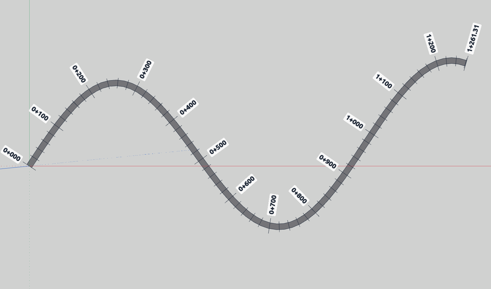

# Progresivas — IngeTrazo extension

Stations (0+000, 0+020, 0+040…) along a traced route: roads, paths, canals,
pipes and the like. / Progresivas a lo largo de un trazo: carreteras,
caminos, canales y demás.

## Español

- La ruta es un trazo (un KML/KMZ traído con *Archivo ▸ Importar ▸
  Georreferencia*, o un trazo dibujado sobre la ortofoto) o una cadena de
  aristas seleccionadas.
- Marcas cada N metros y etiquetas cada M metros; las que se pisan ceden a
  las redondas (kilómetros, medios kilómetros, centenas).
- Etiquetas alineadas a la estaca, paralelas al eje u horizontales, con
  prefijo, color y fondo; cada progresiva se puede editar a mano en el panel.
- Franja opcional del ancho y color de la vía, que puede reemplazar al trazo.
- Sobre el terreno 3D, todo se asienta en el suelo.
- **Láminas (IngeTrazo 0.6.2 o posterior):** las etiquetas se imprimen como
  texto vectorial a una altura en milímetros de papel. Para que se vean sin
  la extensión instalada, «Escribirlas sobre el terreno como geometría».
- Todo queda en un grupo y una capa «Progresivas»: ocultar la capa deja el
  dibujo como estaba, y volver a generar reemplaza las marcas.
- Exporta la lista de progresivas a CSV.

**Instalar:** desde *Extensiones ▸ Obtener extensiones…* (catálogo), o
copiando `progresivas.py` en la carpeta de complementos (*Extensiones ▸
Abrir carpeta de complementos*) y reiniciando IngeTrazo. Luego seleccionar
la ruta y *Extensiones ▸ Progresivas…*

## English

Select a traced path (or a chain of edges) and run *Extensions ▸
Stationing…*: ticks every N metres, labels every M metres that give way
where they would overlap, an optional strip of the route's width, and from
IngeTrazo 0.6.2 the labels printed on the sheets at a height in paper
millimetres. Everything lives in one group and one layer, «Progresivas».

Requires IngeTrazo 0.6.1 or later (0.6.2 or later for labels on sheets).

## Licence

GPL-3.0-or-later. © 2026 Marco Sumari Tellez and IngeTrazo contributors.
